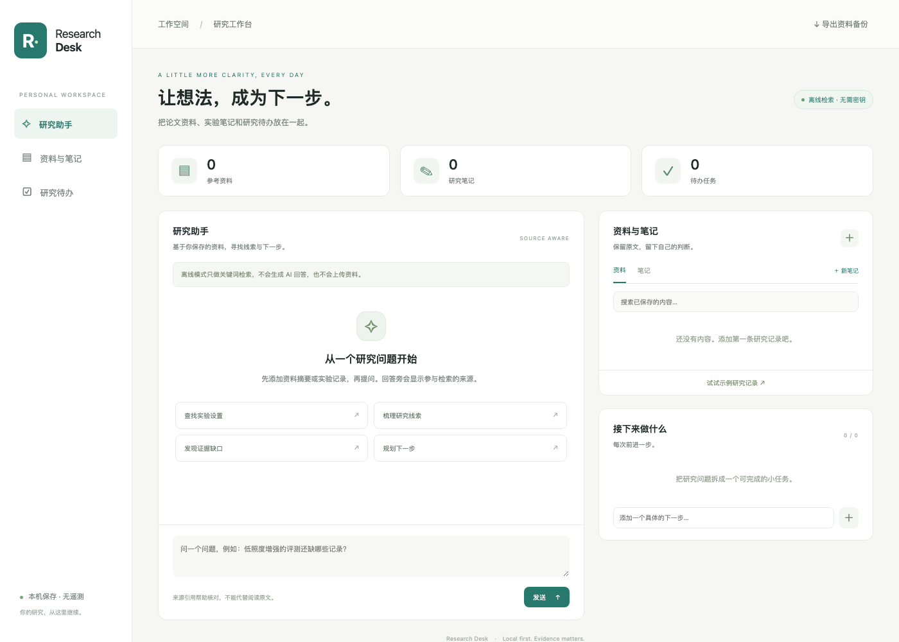

# Research Desk

**论文资料、实验笔记、研究待办，一个本机工作台。**

A local research workspace with source-linked retrieval, notes, tasks, and optional model-assisted answers. Built with Python's standard library and a small browser interface.



## 开始使用

需要 **Python 3.10+**，无需安装第三方 Python 包，无需下载模型或权重。

1. 下载本仓库的 ZIP 并解压。
2. macOS 双击 `start.command`；Windows 双击 `start.bat`。
3. 浏览器打开工作台，点击「试试示例研究记录」或添加自己的资料。

如果双击无法运行，在项目目录执行：

```sh
python3 app.py --open
```

Windows 也可使用 `py -3 app.py --open`。默认地址为 `http://127.0.0.1:8765`。端口占用时使用 `python3 app.py --port 8766 --open`。终端中按 `Ctrl+C` 关闭。

这是本机浏览器应用；仓库提供源码和启动脚本，目前没有打包的 `.dmg` 或 `.exe`。

## 可以做什么

- **资料库**：粘贴论文摘要或实验记录，保留原文链接；按关键词筛选。
- **研究笔记**：保存自己的判断和待核对问题。
- **研究待办**：添加、完成和删除具体任务。
- **来源检索**：英文词语与中文双字匹配，返回最多 5 条资料片段，附 `[S1]` 资料或 `[N1]` 笔记编号。
- **可选模型回答**：接入自己选择的 Chat Completions 兼容服务；发送前提示资料传输。
- **本机存储**：SQLite 持久化，支持 JSON 导出。

默认是**离线检索模式**：展示规则匹配的资料原文，不是假装模型生成的回答。示例内容是研究检查计划，没有虚构的实验结果。

## 可选：连接自己的模型

只有同时设置地址和模型名后才启用模型功能；密钥仅在服务端环境变量中读取。远程服务必须使用 HTTPS，本机服务允许 HTTP。`DESK_CHAT_ENDPOINT` 要填写**完整的请求地址**。

macOS / Linux 示例，假设你已自行运行一个兼容的本机服务：

```sh
export DESK_CHAT_ENDPOINT='http://127.0.0.1:1234/v1/chat/completions'
export DESK_CHAT_MODEL='your-served-model-name'
# 需要认证的服务，再设置 DESK_CHAT_API_KEY
python3 app.py --open
```

PowerShell 示例：

```powershell
$env:DESK_CHAT_ENDPOINT = 'http://127.0.0.1:1234/v1/chat/completions'
$env:DESK_CHAT_MODEL = 'your-served-model-name'
py -3 app.py --open
```

`.env.example` 仅作字段参考，应用不会自动加载 `.env`。本项目不会安装模型、创建付费服务或自动配置 API 密钥。兼容接口结构参考 [OpenAI 官方 Chat Completions 文档](https://developers.openai.com/api/reference/resources/chat/subresources/completions/methods/create)。

模型模式每次只发送**当前问题与匹配的资料片段**，不发送整个资料库或待办。聊天窗口记录仅保存在当前页面内，刷新后清空；多轮历史不会传给模型。模型可能错误引用，需展开来源卡片核对原文。

## 数据与范围

数据默认位于 `data/desk.sqlite3`，已被 Git 忽略。完整备份可关闭应用后复制该文件；恢复时把备份放回相同位置。界面导出的 JSON 可供归档和迁移，目前没有 JSON 导入界面。

应用只监听 `127.0.0.1`，没有遥测、账号系统或自动网页抓取。它保存的是粘贴文本，不解析 PDF、不使用向量模型、不执行代码、不自动浏览网络；这是一款个人研究助手原型，尚未实现自主规划与工具执行的 Agent。资料无需交给模型也能使用笔记、任务与检索。

## 开发与验证

```sh
python3 -m unittest discover -s tests -v
```

测试覆盖 SQLite 持久化、中英文检索、离线不联网、模型请求桩、密钥不进入页面数据、错误处理、HTTP 页面/API，以及来源/Host/请求令牌校验。模型适配器已用本机桩验证，未连接付费模型测试。截图来自实际本机浏览器；Windows 启动脚本尚未在 Windows 系统验证。

```text
app.py          本机服务、存储、检索与可选模型适配
static/         无构建步骤的浏览器界面
start.command   macOS 启动入口
start.bat       Windows 启动入口
tests/          标准库 unittest 测试
```

## 相关项目与许可

产品参考方向：[AnythingLLM](https://github.com/Mintplex-Labs/anything-llm) 的个人知识库、[GPT Researcher](https://github.com/assafelovic/gpt-researcher) 的研究工作流。这里的应用代码为独立实现，没有复制这两个项目的代码或界面资源。

代码采用 [MIT License](LICENSE)。用户保存的论文、图片和其他资料仍遵循各自的许可。
